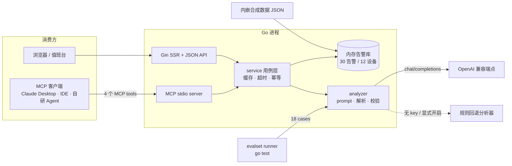

# IoT Alert Agent

> 设备告警 → LLM 分诊 → 工单摘要/处置建议 → 人工确认 → 评测回归。
> 一个用 **Go + Gin + MCP** 实现的、可完整演示的 Agent 闭环项目。


---

## 为什么做这个项目

我在物联网平台侧做过设备接入、告警规则和现场处置流程。迁移到 Agent 平台方向时，我想证明的不是"会调 LLM API"，而是三件更难的事：

1. **把存量平台能力变成 Agent 可调用的工具**——不是写一个聊天框，而是设计 schema、错误语义和幂等边界，让任意 Agent 客户端可以通过 **MCP** 查询告警、读取设备档案、生成分诊建议、确认告警。
2. **约束 LLM 的输出，而不是相信它**——固定 JSON 契约、严格校验、失败不写缓存、无凭据时明确回退到规则引擎，绝不把规则输出伪装成模型输出。
3. **量化 LLM 的输出质量**——18 个带人工标注要点的全合成场景（数据 100% synthetic，告警类型与处置流程仿照真实平台），`go test` 直接跑评测，输出要点命中率（区分“复读原文”与“推理得出”）、定级准确率（模型 vs 规则基线）和失败明细，形成可回归的质量门禁。

一句话：**这是从"物联网平台工程师"走向"Agent 平台工程师"的能力证明，而不是一个 Demo 壳子。**

## 它做了什么

- 内置 **30 条全合成告警 / 12 台合成设备**，覆盖 5 类真实故障：设备离线、低电量、传感器数值异常、OTA 失败、通信抖动。
- 单页 Server-Side Rendering 值班台：告警列表、筛选、详情、设备档案、AI 处置建议、人工确认/关闭、处置时间线。
- **MCP server（stdio）** 暴露 4 个工具：`list_alerts` / `get_device` / `summarize_alert` / `ack_alert`，同一份领域逻辑同时服务 Web 和 Agent。
- **评测集 + Go test runner**：要点命中评分（复读/推理分开统计）、定级准确率、逐用例失败明细、通过阈值；LLM 不可达时可用 mock 模式跑通全链路。
- 任意 OpenAI 兼容端点；base_url / api_key / model / token 预算全部来自环境变量，**无硬编码密钥**。

## 架构



关键点：Web、MCP、评测三端共用 `internal/agent` 的 prompt 契约与输出校验，模型换了、入口换了，行为仍然一致。

## 快速开始

要求：Go 1.25.5+（`mcp-go` v1.5.0 的最低版本）。

```bash
git clone https://github.com/devyunmu/iot-alert-agent.git
cd iot-alert-agent
go mod download

export LLM_BASE_URL="http://127.0.0.1:3000/v1"   # OpenAI 兼容端点
export LLM_API_KEY="sk-..."                      # 只从环境变量读取
export LLM_MODEL="glm-5.3-flash"                 # 换成你的模型
export LLM_MAX_TOKENS=4000                       # 推理型模型建议 4000+
export LLM_TIMEOUT=180s

go run ./cmd/server
# http://127.0.0.1:8080
```

默认只监听回环地址 `127.0.0.1:8080`：服务没有鉴权，绑定 `0.0.0.0` 会把告警读写接口暴露给整个局域网。确需局域网访问时显式覆盖，例如 `ADDR=0.0.0.0:8080`，并自行加访问控制。

**零凭据演示**：不设置 `LLM_API_KEY` 时自动使用确定性规则分析器，页面顶部会显示 `MOCK · mock://rules-v1`，AI 卡片标注"规则回退"，不会把规则结果冒充模型输出。

常用命令：

```bash
make run          # 启动 Web 值班台
make mcp          # 以 stdio 启动 MCP server
make test         # 全部单测
make vet          # go vet
make eval         # 实时 LLM 评测（需 key）
make eval-mock    # 离线评测（无需 key）
```

## MCP 接入

项目核心叙事是 **"物联网平台 API 按 MCP tool schema 暴露给 Agent"**。

```bash
go build -o bin/iot-mcp ./cmd/mcp
./bin/iot-mcp        # stdout 为协议通道，日志全部走 stderr
```

Claude Desktop / 任意 MCP 客户端配置：

```json
{
  "mcpServers": {
    "iot-alert-agent": {
      "command": "/absolute/path/to/bin/iot-mcp",
      "env": {
        "LLM_BASE_URL": "http://127.0.0.1:3000/v1",
        "LLM_API_KEY": "sk-...",
        "LLM_MODEL": "glm-5.3-flash",
        "LLM_MAX_TOKENS": "4000"
      }
    }
  }
}
```

调试可用官方 Inspector：

```bash
npx @modelcontextprotocol/inspector ./bin/iot-mcp
```

### 工具清单

| Tool | 参数 | 行为 | 返回 |
|---|---|---|---|
| `list_alerts` | `status?` `severity?` `type?` `limit?` | 按严重度 + 时间排序的告警队列 | `{count, alerts[]}` |
| `get_device` | `device_id` | 设备档案 + 最近 5 条关联告警 | `{device, recent_alerts[]}` |
| `summarize_alert` | `alert_id` `force?` | 生成/复用分诊建议（摘要、定级、原因、步骤） | `{analysis, alert, device}` |
| `ack_alert` | `alert_id` `operator?` | 幂等确认；已关闭告警返回工具错误 | `{alert, changed, message}` |

设计细节：

- 参数使用 `mcp.Enum` 约束，非法值返回 `isError` 的工具结果而不是协议错误，Agent 能自行纠错。
- `summarize_alert` 默认读缓存，`force=true` 才重新调用模型，避免 Agent 循环烧 token。
- 同一告警重复 `ack_alert` 返回 `changed=false`，不覆盖首次确认人，保留审计语义。
- 所有工具返回 `structuredContent` + 等价文本，兼容只读文本的客户端。

## HTTP API

| Method | Path | 说明 |
|---|---|---|
| `GET` | `/` | 告警列表（`q` / `type` / `severity` / `status`） |
| `GET` | `/alerts/:id` | 告警详情 + AI 建议 |
| `POST` | `/alerts/:id/analyze` | 生成 AI 建议（表单，`force=1` 重算） |
| `POST` | `/alerts/:id/ack` | 确认告警（表单） |
| `POST` | `/alerts/:id/close` | 关闭已确认告警（表单，写入 `closed_at`） |
| `GET` | `/api/alerts` | 告警列表 JSON（支持 `limit`） |
| `GET` | `/api/alerts/:id` | 详情 JSON（含缓存分析） |
| `POST` | `/api/alerts/:id/analyze` | `{"force":true}` |
| `POST` | `/api/alerts/:id/ack` | `{"operator":"..."}` |
| `POST` | `/api/alerts/:id/close` | 关闭已确认告警，返回 `{alert, changed}` |
| `GET` | `/api/stats` | 看板计数 + 当前分析器 |
| `GET` | `/healthz` | 存活探针 |

```bash
curl -s "http://127.0.0.1:8080/api/alerts?status=open&limit=3" | jq

curl -s -X POST http://127.0.0.1:8080/api/alerts/ALT-0021/analyze \
  -H 'Content-Type: application/json' -d '{}' | jq

curl -s -X POST http://127.0.0.1:8080/api/alerts/ALT-0006/ack \
  -H 'Content-Type: application/json' -d '{"operator":"oncall-li"}'

# 关闭必须先确认；响应里 closed_at 即状态机闭环时间
curl -s -X POST http://127.0.0.1:8080/api/alerts/ALT-0006/close | jq '.alert | {status, closed_at}'
```

## 评测：把"感觉还行"变成分数

`evalset/evals.json` 有 **18 个用例 / 76 个关键要点**，覆盖五类告警。每个用例指定：

- 期望严重度（人工复核的判定；其中 4 例故意与数据里的 `baseline_severity` 相反，见下）；
- 4–5 个关键要点，每个要点配置多个可接受表述（如 `9.6` / `高于上限` / `超温`），避免只认一种措辞；
- `requires_inference` 标记：`true` 表示该要点必须由分析推理得出（例如“冷库监测即将失盲，应升级并当日更换”），不能靠复读告警原文命中。

匹配规则：数字按边界匹配（`8.5` 不会命中 `18.5`，`87` 不会命中 `187`，`1.9.0` 不会命中 `11.9.0`），文字忽略大小写与空白；`requires_inference` 要点如果只被“告警原文里也有的表述”命中，不计分。报告打印 `要点命中率`、`推理要点 / 复读要点` 分项，以及“仅复读原文即可命中的要点占比”，避免复读抬高分数。

评分：

```
用例得分 = w_kp × 要点命中率 + w_sev × 定级准确率
总分     = 所有用例得分的平均值
通过条件 = 平均分 ≥ pass_threshold 且 无分析错误
```

`w_kp` / `w_sev` / `pass_threshold` 直接取自 `evalset/evals.json` 的 `scoring` 块，缺省为 `0.8` / `0.2` / `0.75`；报告表头打印本次实际使用的权重，改配置后报告和分数不会脱节。

### 定级标签与规则基线

14 个基线用例的 `expected_severity` 与 `data/alerts.json` 的 `severity` 相同——它来自规则基线，**不是独立的人工真值**，而且基线还会作为 `baseline_severity` 进入 prompt。为了让定级维度真正有区分力，EV-15–EV-18 的期望定级**故意与基线相反**，并把推理依据写进要点：

| 用例 | 基线 | 期望 | 依据 |
|---|---|---|---|
| EV-15 ALT-0015 | warning | info | 车载终端离线 6h20m，但车辆熄火停在场内，未在途、无货品暴露，按信息级记录 |
| EV-16 ALT-0003 | warning | critical | 冷库温湿度传感器电量 9%、续航约 14h，冷链监测即将失盲，属不可见货损风险 |
| EV-17 ALT-0011 | warning | critical | 烟感是消防关键设备，低电量削弱火灾报警上报能力，应按消防优先级处置 |
| EV-18 ALT-0008 | warning | critical | 设定 4℃ 的冷库回风实测 8.2℃、偏差持续 25 分钟，已进入货品不安全区间 |

所以报告里的“定级准确率”应读作 **模型判断 vs 人工复核标签（其中 4 例明确反对规则基线）**，不是“模型与规则引擎的一致率”。`TestEvalSetHonesty` 固化这三条约束：反向用例 ≥3、每个反向用例至少有 2 个推理要点、`requires_inference` 要点的表述不能在告警原文里出现。

运行：

```bash
# 离线（默认）：验证评测链路与规则回退，不产生 API 费用
go test ./evalset -v

# 实时：需要 LLM_API_KEY
EVAL_MODE=live EVAL_WORKERS=3 LLM_MAX_TOKENS=5000 LLM_TIMEOUT=240s \
  go test ./evalset -v

# 指定模型 / 只跑前 N 条
EVAL_MODE=live LLM_MODEL=gpt-4o-mini EVAL_LIMIT=5 go test ./evalset -v

# 不带 EVAL_MODE 时默认 mock，`go test ./...` 不会意外产生模型费用。
```

### 真实评测结果

以下为 2026-11-17 的实跑结果（`glm-5.3-flash`，18 条全量，并发 3，OpenAI 兼容网关）：

```text
=== IoT Alert Agent · 评测报告 ===
模式: live     分析器: glm-5.3-flash                用例: 18
评分: 要点命中 80% (weight 0.80) + 定级准确率（模型 vs 规则基线）20% (weight 0.20)，通过阈值 0.75
------------------------------------------------------------------------------
CASE    ALERT      LEVEL  SEV  KEYPOINTS SCORE  LATENCY 
EV-01   ALT-0001   crit   ✓    5/5       1.00   129414ms
EV-02   ALT-0002   crit   ✓    4/4       1.00   33957ms 
EV-03   ALT-0005   crit   ✓    5/5       1.00   18106ms 
EV-04   ALT-0007   warn   ✗    4/4       0.80   186500ms
EV-05   ALT-0006   warn   ✗    3/4       0.60   65816ms 
EV-06   ALT-0009   crit   ✓    4/4       1.00   14151ms 
EV-07   ALT-0012   crit   ✓    4/5       0.84   17702ms 
EV-08   ALT-0013   crit   ✓    4/4       1.00   15110ms 
EV-09   ALT-0018   warn   ✓    4/4       1.00   44369ms 
EV-10   ALT-0021   crit   ✓    4/4       1.00   26333ms 
EV-11   ALT-0025   crit   ✓    4/4       1.00   61235ms 
EV-12   ALT-0027   crit   ✓    4/4       1.00   32000ms 
EV-13   ALT-0020   crit   ✓    4/5       0.84   36088ms 
EV-14   ALT-0030   warn   ✗    4/4       0.80   21652ms 
EV-15   ALT-0015   info   ✗    0/4       0.00   22062ms 
EV-16   ALT-0003   crit   ✗    2/4       0.40   52659ms 
EV-17   ALT-0011   crit   ✓    0/4       0.20   64690ms 
EV-18   ALT-0008   crit   ✓    0/4       0.20   33644ms 
------------------------------------------------------------------------------
要点命中率 0.776 (59/76) · 推理要点 22/38 · 复读要点 37/38 · 定级准确率 0.722 · 平均得分 0.760 · 错误 0
可复读要点 38/76 (50%)：仅抄告警 title/message 即可命中，不反映分诊能力；推理要点按 requires_inference 单独计分
未命中明细:
  EV-04 ALT-0007: 定级 critical != 期望 warning
  EV-05 ALT-0006: 定级 critical != 期望 warning
  EV-05 ALT-0006: 漏检 kp2 (关注重传/丢包)
  EV-07 ALT-0012: 漏检 kp5 (通风/断电/排烟)
  EV-13 ALT-0020: 漏检 kp5 (备件/工单)
  EV-14 ALT-0030: 定级 critical != 期望 warning
  EV-15 ALT-0015: 定级 warning != 期望 info
  EV-15 ALT-0015: 漏检 kp1 (推理：离线发生在收车停场期间，属于可预期的正常状态，无需当班处置)
  EV-15 ALT-0015: 漏检 kp2 (推理：按信息级记录，下次出车前确认设备重新上线即可)
  EV-15 ALT-0015: 漏检 kp3 (推理：车辆未在途、无货品暴露，因此不应升级为冷链/安全事件)
  EV-15 ALT-0015: 漏检 kp4 (推理：离线时长与停车时段吻合，可排除被盗或异常拆卸)
  EV-16 ALT-0003: 定级 warning != 期望 critical
  EV-16 ALT-0003: 漏检 kp1 (推理：真正风险是冷链监测即将出现盲区，不是普通低电量)
  EV-16 ALT-0003: 漏检 kp3 (推理：说明升级理由——失去温湿度监测会造成不可见的货损，故定级高于基线)
  EV-17 ALT-0011: 漏检 kp1 (推理：低电量的真实后果是火灾报警可能漏报，而非单纯电量不足)
  EV-17 ALT-0011: 漏检 kp2 (推理：按消防优先级当日更换电池/整机，不走常规低电量工单)
  EV-17 ALT-0011: 漏检 kp3 (推理：升级依据是消防设备失效会危及人身安全，故高于基线 warning)
  EV-17 ALT-0011: 漏检 kp4 (推理：更换后做报警测试/心跳验证，确认告警链路恢复)
  EV-18 ALT-0008: 漏检 kp1 (推理：8.2°C 的实际回风已进入货品不安全区间，不是单纯的执行器偏差)
  EV-18 ALT-0008: 漏检 kp2 (推理：定级依据是冷链温控失效影响业务连续性，故高于基线 warning)
  EV-18 ALT-0008: 漏检 kp3 (推理：现场测温并评估在库货品，必要时转移/隔离货品)
  EV-18 ALT-0008: 漏检 kp4 (推理：检查执行器阀门/开度与实际制冷输出是否脱节)
结论: PASS（阈值 0.75，错误数 0）

总耗时 305.4s（并发 3）
```

**旧分数不作数。** 上一版 README 的 `0.933 (56/60)` 是在裸子串匹配、没有区分“复读/推理”、且 14 个定级标签全部等于规则基线的口径下得到的，属于乐观偏差；那次运行没有保存模型原始输出，无法用新规则回溯重算，因此不能与新数字直接比较。按当前口径，同一模型的诚实分数是 **要点命中 0.776（59/76）、定级准确率 0.722、平均得分 0.760**——只是擦线通过（阈值 0.75）。

**结果解读（比分数本身更重要）：**

- **复读 37/38，推理 22/38**：引用数值、复述现象几乎满分；一旦要求“推断后果并改变优先级”，EV-15–EV-18 的 16 个推理要点命中 **0/16**。当前 prompt 擅长把事实组织成摘要，不擅长按业务规则重定级——这是最该修的短板，比总分更能说明问题。
- **定级准确率 0.722（13/18）**：EV-04/05/14 把 warning 升成 critical（仍偏保守）；EV-15 该降为 info 却保持 warning；EV-16 该升为 critical 却保持 warning；EV-17/18 定级正确但推理要点 0/4，模型没有写出升级理由，定级对也可能是照抄基线的副作用。
- **PASS 是擦线**：0.760 比阈值高 0.01，样本只有 18 条。它能防明显回退，不能证明质量充分。
- **延迟 14–187s**：多数用例 14–65s；EV-01（129s）与 EV-04（187s）触发了“空 content → 2 倍 token 预算重试”的长尾。并发 3 全量 305s。同步阻塞值班页面不可接受，生产应改队列 + 轮询/推送（见 TODO）。
- **mock 模式 0.816 / 0.778 / 0.800**（复读要点 38/38，推理要点 24/38）。规则文案与要点词表高度重叠，这个分数只证明评测链路能跑通，不是质量门禁；报告会明确标注 `mock://rules-v1`。

## 项目结构

```text
.
├── cmd/
│   ├── server/          # Web + JSON API 入口
│   └── mcp/             # MCP stdio 入口
├── data/
│   ├── alerts.json      # 30 条合成告警
│   ├── devices.json     # 12 台合成设备
│   └── data.go          # go:embed，二进制自包含
├── evalset/
│   ├── evals.json       # 18 用例 / 76 要点
│   └── eval_test.go     # go test 评测 runner
└── internal/
    ├── agent/           # prompt 契约、JSON 解析校验、规则回退
    ├── app/             # 依赖装配
    ├── config/          # 纯环境变量配置
    ├── domain/          # Alert / Device / Analysis
    ├── eval/            # 评分、聚合、报告渲染
    ├── llm/             # 轻量 OpenAI 兼容客户端（net/http）
    ├── mcpserver/       # 4 个 MCP 工具
    ├── service/         # 用例层：缓存、超时、幂等
    ├── store/           # 并发安全内存仓储
    └── web/             # Gin 路由、内嵌模板与静态 CSS
```

## 设计取舍

- **Go + Gin，而不是 Python/LangChain**：目标是展示 Agent 能力可以长在平台工程里——单二进制部署、强类型、标准库 HTTP 客户端、无框架黑盒。直接依赖只有三个：`gin`、`mark3labs/mcp-go` 和标准库补充件 `golang.org/x/sync`（并发请求合并）。
- **内存仓储**：演示要一条命令启动且结果可复现。`store.Store` 目前是具体类型（`service` 直接持有 `*store.Store`，`Filter` / `Stats` / `ErrX` 也是具体类型）；替换 SQLite/Postgres 需要先在 service 层抽一个 interface（改动局限在 service 包），不是零成本。当前代价是进程重启后确认状态与分析缓存丢失（见 TODO）。
- **重试与超时分离**：`LLM_TIMEOUT` 是单次请求预算，一次分诊的总预算是 `单次超时 × 3`，重试不会继承已耗尽的首轮预算；空 content 以 2 倍 token 预算重试一次（上限 16k），429/5xx 优先按 `Retry-After`、否则按指数退避重试一次，401/400 等客户端错误不重试。
- **严格输出契约**：`summary` / `severity` / `actions` / `confidence` 为必填；`severity_reason` / `likely_causes` 可选。缺字段、级别非法、动作为空、confidence 缺失或不在 `[0,1]` 一律报错并且不写缓存——不做静默修正，也不猜测默认值。
- **MCP 错误语义**：找不到设备/告警、非法枚举、确认已关闭告警，均返回 `isError` 工具结果，让 Agent 能读到原因并自我纠正。
- **规则回退可见**：无 key 或显式 `LLM_MOCK=1` 时使用规则分析器，UI、API、评测报告都带 `mock` 标记。
- **合成数据**：设备号、站点、固件版本、错误码全部虚构，仓库不含任何真实客户、设备或公司信息。

## 质量与验证

```bash
go vet ./...                 # 通过
go test ./... -count=1       # 全部通过（store / config / agent / llm / service / web / mcp / eval）
go test -race ./...          # 通过（mock 模式）
```

覆盖的关键路径：

- 数据集完整性：30 告警、12 设备、5 类告警、设备引用完整；全部时间戳落在同一基准时间线上（无 `last_seen > now`、无缺 `closed_at` 的 closed 状态、离线时长与字段推算一致）；
- 告警排序/筛选/搜索、确认幂等、已关闭冲突、空操作人兜底；
- 状态机：open → acked → closed，关闭写 `closed_at`、重复关闭幂等、未确认不可关闭；
- 模型输出：正常、带 Markdown 围栏、前后缀噪声、缺字段、非法级别、confidence 缺失/越界/非数字；
- 并发分诊：6 个冷缓存并发请求只触发 1 次上游 `/chat/completions`；`force` 不与普通请求共享 flight；leader 取消不影响等待者，等待者可自行超时退出；
- LLM 客户端：鉴权头、非 2xx、空 choices、空 content、超时、`temperature=0` 显式落线、429 退避重试、401 不重试、重试拿到独立预算；
- Web：列表渲染、筛选、详情、分析缓存、确认、关闭、404、API JSON；
- MCP：`tools/list` 工具面、四个工具的调用结果、非法参数、重复确认；
- 评测：数字边界匹配（`8.5` ≠ `18.5`）、推理要点复读不计分、可配置评分权重、报告打印实际权重与复读/推理分项、评测集反向用例与防泄漏守卫。

## 局限与 TODO

- **评测口径的已知局限（如实披露）**：
  - 14 个基线用例的期望定级等于规则基线，4 个反向用例是单人写明的判定，**都不是双人独立标注 + 仲裁**，因此定级准确率只能当方向性指标。
  - 即便收紧了数字边界匹配，原 60 个要点中仍有 **38 个（63%）仅靠复读告警 title/message 即可命中**（旧裸子串口径为 39 个 / 65%）；全量 76 个要点中可复读的占 50%。现已把 38 个要点标为 `requires_inference` 并要求其表述不出现在原文，但“复读要点”仍会抬高总分。
  - 18 条样本只够做回归，不够做模型选型或统计结论；mock 模式仍会 PASS（0.800），它验证链路而不是质量。
- [ ] 持久化：告警确认状态与分析缓存目前只在内存，重启即重置；接 SQLite/Postgres 并保留审计表。
- [ ] 鉴权与多租户：当前是本地演示服务，无登录/RBAC，因此默认只监听 `127.0.0.1`；公开部署前必须加鉴权并显式设置 `ADDR`。
- [ ] 同步分析 → 异步任务：实测单条 14–187s，应改为队列 + 前端轮询/SSE，避免阻塞请求。
- [ ] MCP 传输：目前 stdio；补充 Streamable HTTP/SSE 以支持远程 Agent 与多客户端。
- [ ] Prompt 版本化：把 prompt/rubric 纳入评测基线，CI 中对分数回退设门禁。
- [ ] 评测增强：加入少样本定级示例、按告警类型分组的分数、成本（token）统计。
- [ ] 人工反馈闭环：把值班人员对 AI 建议的采纳/修改记录写回评测集。

## 数据与隐私

`data/*.json` 为全合成演示数据（30 条告警 / 12 台设备），设备号、站点、固件版本、错误码均为虚构，不含任何真实设备号、客户名或公司信息。仓库不包含任何 API key、token 或内网地址；运行时凭据只从环境变量读取。

## License

MIT